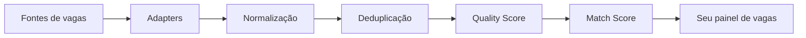

<div align="center">

# Rumo

### Rumo à sua próxima vaga.

**Encontre as vagas certas, chegue preparado e conquiste a oportunidade — tudo em um só lugar.**

[](#roadmap)
[](https://www.typescriptlang.org/)
[](https://nextjs.org/)
[](https://fastify.dev/)
[](https://supabase.com/)

[Visão geral](#visão-geral) • [Funcionalidades](#funcionalidades) • [Como funciona](#como-funciona) • [Stack](#stack) • [Roadmap](#roadmap) • [Primeiros passos](#primeiros-passos)

[English](../README.md) | **Português**

</div>

> [!NOTE]
> O Rumo está em fase inicial de desenvolvimento. O primeiro módulo em construção é o **Job Finder**.

## Visão geral

Procurar emprego hoje significa abrir dez abas, repetir a mesma busca em vários sites, perder vagas boas no meio de anúncios duplicados ou suspeitos e, no fim, mandar o mesmo currículo genérico para todas.

O **Rumo** é um Career Hub que organiza toda a jornada:

- **Descobrir** — vagas nacionais e internacionais de várias fontes, em um só lugar, sem duplicatas.
- **Decidir** — cada vaga recebe uma nota de qualidade e uma nota de compatibilidade com o seu perfil, com os motivos explicados.
- **Se preparar** — currículo otimizado para ATS e direcionado para cada vaga, e entrevistas simuladas por voz com IA *(em breve)*.

## Funcionalidades

### Job Finder — *em desenvolvimento*

- **Busca unificada** em fontes nacionais e internacionais: ATS de empresas (Greenhouse, Lever, Ashby), agregadores (Adzuna, Remotive e outros), Hacker News e comunidades brasileiras no GitHub.
- **Deduplicação inteligente**: a mesma vaga publicada em vários lugares aparece uma vez só.
- **Job Quality Score**: identifica anúncios incompletos, desatualizados ou com sinais de fraude.
- **Candidate Match Score**: mostra o quanto a vaga combina com as suas skills, senioridade, localização e objetivos — e o que está faltando.
- **Filtros completos**: cargo, tecnologias, senioridade, país, modalidade, salário e critérios personalizados.
- **Favoritos e acompanhamento de candidaturas**, com histórico de cada processo.

> [!TIP]
> As duas notas são independentes de propósito: uma vaga pode ser excelente e não ser para você — ou combinar com você e ser um anúncio duvidoso. O Rumo mostra as duas coisas.

### Resume Generator — *próxima etapa*

Currículos otimizados para ATS e direcionados a cada vaga, construídos **a partir do seu histórico real**. O Rumo destaca o que é relevante, usa as palavras-chave certas e mostra quais requisitos foram atendidos — sem nunca inventar nada.

### Interview Simulator — *etapa futura*

Entrevistas simuladas por voz em tempo real, em português e inglês, baseadas na vaga e no seu currículo. Ao final, um relatório com pontos fortes, erros técnicos, lacunas de conhecimento, comunicação, pronúncia e vocabulário em inglês, e um plano de estudo.

## Como funciona



1. Cada fonte tem um **adapter isolado** que converte os dados para um formato padrão.
2. As vagas são **normalizadas** (cargo, empresa, localização, salário, skills) e **deduplicadas** entre fontes.
3. Cada vaga recebe um **Quality Score**; para cada usuário, um **Match Score** com o detalhamento dos critérios.
4. Você filtra, favorita e acompanha suas candidaturas no painel.

> [!IMPORTANT]
> O Rumo usa apenas APIs oficiais, feeds públicos e integrações autorizadas, respeitando os termos de uso de cada provedor.

## Stack

| Camada | Tecnologias |
|---|---|
| Frontend | Next.js, React, TypeScript, TanStack Query, Tailwind CSS |
| Backend | Node.js, Fastify, TypeScript, Zod |
| Dados | PostgreSQL (Supabase), Prisma, pg-boss |
| Autenticação | Supabase Auth — e-mail e senha, GitHub e Google |
| Qualidade | Vitest, Biome, GitHub Actions |

Arquitetura de **monólito modular** em monorepo (pnpm workspaces), desacoplada do provedor de infraestrutura e preparada para evoluir para SaaS.

```
rumo/
├── apps/
│   ├── web/          # Next.js
│   └── api/          # Fastify (API + worker)
└── packages/
    ├── contracts/    # schemas Zod compartilhados
    └── config/       # configurações base
```

## Roadmap

- [x] Fundação do monorepo (pnpm, Biome, TypeScript)
- [x] Esqueleto da API e da web com contratos compartilhados
- [x] Banco de dados (Supabase + Prisma), segurança e CI
- [ ] Autenticação (e-mail e senha, GitHub, Google)
- [ ] Modelo de vagas e import manual
- [ ] Primeiras fontes de vagas (ATS e agregadores)
- [ ] Ingestão agendada
- [ ] Busca e filtros
- [ ] Deduplicação entre fontes
- [ ] Favoritos e acompanhamento de candidaturas
- [ ] Perfil profissional e taxonomia de skills
- [ ] Job Quality Score
- [ ] Candidate Match Score
- [ ] Resume Generator
- [ ] Interview Simulator

## Primeiros passos

**Pré-requisitos:** [Node.js 24 LTS](https://nodejs.org/), [pnpm](https://pnpm.io/) e um projeto no [Supabase](https://supabase.com/).

```bash
git clone https://github.com/LucasMedici/rumo.git
cd rumo
pnpm install
cp apps/api/.env.example apps/api/.env      # preencha DATABASE_URL (Supabase → Connect → Session pooler)
cp apps/web/.env.example apps/web/.env.local
pnpm --filter @rumo/api db:migrate          # aplica as migrations do banco
pnpm dev
```

- Web: http://localhost:3000
- API: http://localhost:3333/health

> [!IMPORTANT]
> No seu projeto Supabase, ative o **Enforce SSL** (Database → Settings) e mantenha a **Data API** expondo só o schema `public` (Project Settings → Data API) — nunca exponha o `rumo`. Não desligue: o PostgREST continua rodando e registra um erro a cada ~30s. A API conecta com TLS verificado contra a CA raiz do Supabase (`apps/api/certs/supabase-ca.crt`).

Rode as verificações com `pnpm lint`, `pnpm typecheck` e `pnpm test`.

<div align="center">

**Rumo** — Rumo à sua próxima vaga.

</div>
